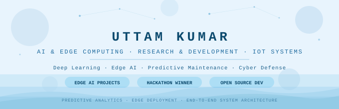

[;LLMs+%7C+Deep+Learning+%7C+NLP+%7C+Explainable+AI;Research+Intern+%40+IISER+Bhopal+%26+NIT+Patna;3+IEEE+Research+Papers+(Accepted+%2F+Published);Winner+-+East+India's+Largest+AI+Hackathon+(%E2%82%B92.5L))](https://git.io/typing-svg)

---

## 🧭 Research Focus & Domains

> *Investigating representation learning, interpretability, and fine-tuning across Large Language Models, Deep Neural Architectures, and Applied Machine Learning.*
> 
---

## 📄 Publications & Research Output

> **3 Papers Accepted / Published / Under Review across IEEE Conferences**

| # | Title | Venue | Status |
|---|-------|-------|--------|
| 1 | **EdgeGuard: Lightweight AI-Driven IDS for Real-Time Cyberattack Mitigation on Edge Devices** | IEEE AIML Applications Conference | **Published (IEEE)** DOI: [10.1109/AIMLA67915.2026.11522334](https://doi.org/10.1109/AIMLA67915.2026.11522334) |
| 2 | **Multi-Environment Evaluation of Edge-Based LoRa Communication for Real-World IoT Deployments** | IEEE International Conference on Instrumentation | **Accepted (IEEE)** |
| 3 | **AI-Driven Blood Group Detection from Fingerprints: Deep Learning with Quantised Edge Inference on IoT Hardware** | 4th IEEE Intl. Conf. on Ambient Intelligence in Health Care (ICAIHC 2026) | **Under Review** |

---

## 🏛️ Research Experience

- 🔬 **Summer Research Intern — IISER Bhopal** *(Dept. of EECS | May 2026 – Jul. 2026)*  
  *Explainable LLM-Based CrowdRE Software Requirements Classification under Dr. Arpit Sharma, Associate Professor.*  
  - Architected an LLM pipeline to classify crowd-sourced software requirements (functional & non-functional) from user feedback.
  - Integrated **Explainable AI (XAI)** techniques to render neural classification decisions fully transparent and interpretable for stakeholders.
  - Evaluated prompt fidelity and explanation quality across qualitative and quantitative benchmarks on CrowdRE datasets.

- 🧠 **Winter Research Intern — National Institute of Technology (NIT) Patna** *(Dec. 2025)*  
  *Design and Implementation of a Multilingual Humor Generation System using Large Language Models.*  
  - Formulated prompt engineering strategies, constraint handlers, and response rerankers for multilingual text synthesis.
  - Benchmarked generative outputs against the MWAHAHA dataset using Mistral-7B-Instruct, achieving **76% human joke recognition** and **94% constraint satisfaction**.

---

## 🚀 Key Projects & Implementations

| Project | Highlights & Tech Stack | Link |
|---|---|---|
| **🎭 Multilingual Humor Generation (LLMs)** | Modular generation pipeline leveraging **Mistral-7B-Instruct** and MWAHAHA benchmark. Integrates prompt construction, heuristic quality filters, and constraint-aware generation. |  |
| **🔍 Multi-Label Toxicity Detection (DistilBERT + XAI)** | Deep NLP cyberbullying detection using fine-tuned **DistilBERT** paired with **SHAP interpretability**. Outperforms classical baselines with **91.7% accuracy** and **0.99 ROC-AUC**. |  |
| **🎓 EdgeShiksha** | AI Adaptive Learning, Diagnostic Assessment & Multilingual Voice Mentor Platform for Bharat. Multi-agent architecture with localized offline inference capabilities. |  |
| **🚆 Metro Predictive Maintenance Benchmark** | RUL estimation framework on industrial multi-sensor time-series. Benchmarks 10+ architectures including **TabNet ($R^2=0.9937$)**, XGBoost, and Transformers with temporal feature engineering. |  |
| **🛡️ AI-Powered Anomaly-Based IDS** | Real-time threat detection engine utilizing Random Forest and LSTM architectures. Features iptables automated IP blocking and an interactive monitoring dashboard. |  |
| **🔬 Edge-Based Blood Cell Classification** | 9-class peripheral blood cell recognition on Mendeley dataset (17K+ images). Benchmarks ResNet, DenseNet, VGG, and EfficientNet with watershed morphological segmentation. |  |

---

## 🛠️ Technical Skills

### 🧠 LLMs & Generative AI

### 🔬 NLP, Prompt Engineering & Evaluation

### 📊 Deep Learning, ML & Data Science

### 💻 Programming & Core Languages

---

## 🏆 Honors & Key Achievements

- 🥇 **Winner — East India’s Largest AI Hackathon (2025)**: Awarded ₹2.5 Lakhs prize pool for innovative AI solutions.
- 🥇 **Winner — Cybersecurity Hackathon (2025)**: 1st Place at Amity University.
- 💻 **LeetCode:** Solved **200+ DSA Problems** (Algorithms & Data Structures).
- 🎓 **Academic Excellence:** **CGPA 9.51** in BS Computer Science & Data Analytics at **IIT Patna**.

---

## 📊 GitHub Analytics

---

## 🤝 Let's Connect

*Open to research collaborations in Large Language Models, Explainable AI, and Transformer Architectures.*

---

Indian Institute of Technology, Patna · BS in Computer Science & Data Analytics · Class of 2026

